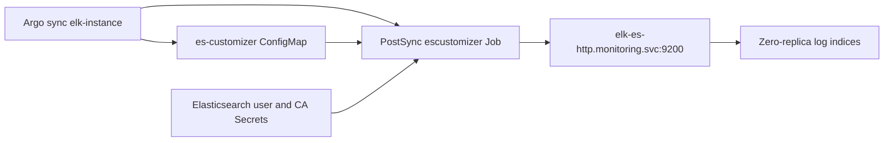
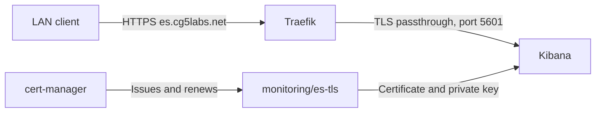

# ElasticSearch and Kibana (ELK) 

## Requirements:
Default storage class defined for persistent storage claims, e.g. NFS.

## Install ELK Operator:

```
$ k apply -f elasticsearch/all-in-one.yaml
```

## Install ElasticSearch:

```
$ k create ns elastic
$ k apply -f elasticsearch/elk-mini.yaml -n elastic
```

## Install Kibana:

```
$ k apply -f elasticsearch/kibana.yaml -n elastic
```

## Check ELK cluster:
```
vagrant@cluster1-master1:~$ k get elastic -n elastic
NAME                                             HEALTH   NODES   VERSION   PHASE   AGE
elasticsearch.elasticsearch.k8s.elastic.co/elk   yellow   1       7.13.2    Ready   7h55m

NAME                               HEALTH   NODES   VERSION   AGE
kibana.kibana.k8s.elastic.co/elk   green    1       7.13.2    7h51m
vagrant@cluster1-master1:~$
```

## Access Kibana from Vagrant host:

```
vagrant@cluster1-master1:~$ k get secret -n elastic elk-es-elastic-user -o=yaml
vagrant@cluster1-master1:~$ kubectl port-forward --address 10.0.2.15 service/elk-kb-http 3000:5601
```

## ELK cluster customization
The target cluster intentionally runs one Elasticsearch data node. A replica shard
cannot share a node with its primary, so log indices must use zero replicas to
reach green health. Replica counts belong to indices, not `nodeSets.config`.



The existing customizer manifests now live in `elk-instance/`, where the
`elasticsearch-instance` Argo Application includes them automatically.
The Job runs sequentially:

1. Creates the existing `hot-warm-delete` ILM policy and zero-replica Logstash template.
2. Creates a zero-replica `fluent-bit-*` template for future daily Fluent Bit indices.
3. Creates a zero-replica `kube-events`/`kube-events-*` template and sets existing Fluent Bit, Logstash and event indices to zero replicas, disabling automatic replica expansion.
4. Waits up to 60 seconds for green cluster health, failing visibly if unassigned shards remain.

Authentication uses the `elastic` key from `monitoring/elk-es-elastic-user`.
HTTPS verifies the service certificate using `elk-es-http-certs-public/ca.crt`.
The PostSync hook is recreated for each full sync; successful Jobs are removed,
while failed Jobs remain available for inspection. Selective sync does not run hooks.

For a manual run from the repository root:

```sh
kubectl apply -f efk/elasticsearch/elk-instance/es-customizer-cm.yaml
kubectl apply -f efk/elasticsearch/elk-instance/es-customizer-job.yaml
kubectl wait -n monitoring --for=condition=complete job/escustomizer --timeout=600s
kubectl logs -n monitoring job/escustomizer
```

For subsequent manual runs, delete only the previous `escustomizer` Job before
applying it again. Zero replicas provide no redundant shard copy; retain backups.
This customizer deliberately leaves system indices and unrelated index templates
unchanged. Other indices with replicas can still make the cluster yellow and
need their own index/template settings.

## Kibana TLS with Traefik

The Argo CD application deploys `elk-instance/` into `monitoring`.
Traefik passes TLS through to Kibana, which presents the cert-manager certificate
from `es-tls` instead of an ECK-generated self-signed certificate.



- **Traefik:** Uses `traefik-external` and `websecure`, routes by SNI, and retains
  the `192.168.17.0/24` TCP allowlist. It does not terminate TLS or load `es-tls`.
- **Kibana:** References `spec.http.tls.certificate.secretName: es-tls`; the Secret
  must be in the same namespace and contain `tls.crt` and `tls.key`.
- **cert-manager:** The explicit `Certificate` in `es-cg5labs-net.yaml` replaces
  the old nginx Ingress's certificate issuance annotation and maintains `es-tls`.
  It requires the namespaced `Issuer` `monitoring/letsencrypt-production`.
  Keep that Issuer's ACME challenge solver functional independently of the
  retired nginx controller; cert-manager does not infer issuance from Traefik CRDs.

Sync the Argo CD application, or apply the manifests directly:

```sh
kubectl apply -f elasticsearch/elk-instance/es-cg5labs-net.yaml
kubectl wait -n monitoring --for=condition=Ready certificate/es-tls --timeout=180s
kubectl apply -n monitoring -f elasticsearch/elk-instance/kibana.yaml
kubectl rollout status -n monitoring deployment/elk-kb
curl -Iv https://es.cg5labs.net
```

Run the URL check from an allowed LAN address without `-k` so certificate trust
and hostname verification remain enabled. Do not reapply `es-ingress.yaml.nginx`.
