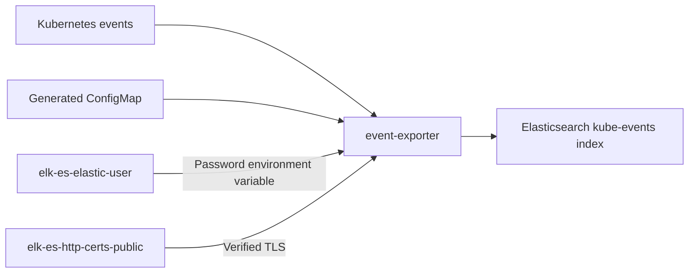

# Kubernetes-Event-Exporter

Small interface to capture K8s cluster events and forward them to various targets. Sample config with ElasticSearch as log target.

The exporter runs in `monitoring` and watches events across all namespaces using
an events-only ClusterRole. Its Elasticsearch receiver writes to `kube-events`
at `https://elk-es-http.monitoring.svc:9200`.



`deploy/config.yaml` uses `${ELASTICSEARCH_USER}` and
`${ELASTICSEARCH_PASSWORD}` placeholders: exporter v0.10 expands environment
variables before parsing YAML. The Deployment uses user `elastic` and the
`elastic` key from `monitoring/elk-es-elastic-user`; no credentials are stored
in the ConfigMap. The old Fluentd/Ruby interpolation syntax is not supported.

TLS verification remains enabled. `SSL_CERT_FILE=/certs/ca.crt` loads ECK's CA
through Go's certificate loader because v0.10's `tls.caFile` implementation only
adds CA roots when client certificate authentication is also configured.
The pinned Opsgenie project is deprecated; its Elasticsearch sink does not
check HTTP error status codes, so verify indexed events, not just pod readiness.

Kustomize generates the ConfigMap from `config.yaml` and updates the Deployment's
reference when configuration changes. One replica with `Recreate` avoids
duplicate watchers during rollouts. Restart the Deployment after password rotation;
Secret-backed environment variables are read only at container startup.

Commit and push changes before creating the Argo Application:

```sh
kubectl apply -f efk/kubernetes-event-exporter/argocd/app.kubernetes-event-exporter.yaml
```

First sync `elasticsearch-instance` to install the customizer's zero-replica
`kube-events` template for this single-node cluster. The customizer also fixes
existing event indices; the event template intentionally has no retention policy.
For deployment without Argo, run `kubectl apply -k efk/kubernetes-event-exporter/deploy`.
Both Elasticsearch Secrets must exist in `monitoring`.

See:
* https://github.com/opsgenie/kubernetes-event-exporter
* https://github.com/resmoio/kubernetes-event-exporter

