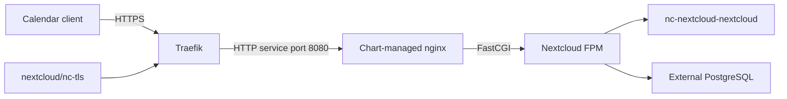

# Nextcloud clean installation with Helm 9.4.1 and Traefik

## Table of contents

- [Sources and version-specific settings](#sources-and-version-specific-settings)
- [1. Preflight and ownership](#1-preflight-and-ownership)
- [2. Review the target Helm values](#2-review-the-target-helm-values)
- [Render and check before destructive work](#render-and-check-before-destructive-work)
- [3. Stop the application and wipe only its old PVC contents](#3-stop-the-application-and-wipe-only-its-old-pvc-contents)
- [4. Review the target Traefik manifest](#4-review-the-target-traefik-manifest)
- [5. Install 9.4.1 and switch traffic](#5-install-941-and-switch-traffic)
- [Verify the persisted database](#verify-the-persisted-database)
- [6. Retire obsolete resources safely](#6-retire-obsolete-resources-safely)
- [7. Configure Calendar, Tasks and external CalDAV access](#7-configure-calendar-tasks-and-external-caldav-access)
- [Enable applications and create a dedicated account](#enable-applications-and-create-a-dedicated-account)
- [Network and route boundaries](#network-and-route-boundaries)
- [Configure an iPhone or other client](#configure-an-iphone-or-other-client)
- [Verify from both inside and outside the LAN](#verify-from-both-inside-and-outside-the-lan)
- [8. Retrospective and root cause analysis](#8-retrospective-and-root-cause-analysis)
- [Incident causes and corrective changes](#incident-causes-and-corrective-changes)
- [SQLite to PostgreSQL conversion and recovery](#sqlite-to-postgresql-conversion-and-recovery)
- [Final state and prevention](#final-state-and-prevention)

Install a new Nextcloud instance using Helm chart **9.4.1** (Nextcloud
**35.0.2**), the existing empty PGO database, and the existing Nextcloud PVC
after wiping its old contents. This is a destructive fresh installation:
old calendar data, users and shares are not recovered.

**The rebuilt instance has since been converted from SQLite to PostgreSQL
with its new calendar data preserved. Do not repeat the PVC wipe or
empty-database installation steps on that populated instance.**

The target configuration is already maintained in these repository files:

- [nextcloud-values.yaml](nextcloud-values.yaml): minimal Helm 9.4.1 overrides
  for nginx/FPM, PGO credentials, persistent storage and background jobs.
- [nc-cg5labs-net.yaml](nc-cg5labs-net.yaml): Traefik HTTP/HTTPS routes,
  `nc-tls` certificate reference, upload limit and response-header policy.

Use these files directly with the commands below. Do not deploy the legacy
`values.yaml` or recreate the removed Apache/DAV rewrite configuration.



- **Traefik:** Terminates TLS using `nc-tls`, redirects HTTP to HTTPS and
  forwards requests without application-path rewrites.
- **Chart-managed nginx:** Uses the chart's default configuration for pretty
  URLs, PHP routing, protected directories and CalDAV/CardDAV discovery.
  This is an application sidecar, not the obsolete ingress-nginx controller.
- **Nextcloud FPM:** Initializes the empty database using the PGO Secret and
  serves the application. Helm also manages a background-cron sidecar.

## Sources and version-specific settings

Reviewed upstream main and the pinned release:

- [Current values](https://github.com/nextcloud/helm/blob/main/charts/nextcloud/values.yaml)
- [9.4.1 values](https://github.com/nextcloud/helm/blob/nextcloud-9.4.1/charts/nextcloud/values.yaml)
- [9.4.1 chart metadata](https://github.com/nextcloud/helm/blob/nextcloud-9.4.1/charts/nextcloud/Chart.yaml)
- [Default nginx configuration](https://github.com/nextcloud/helm/blob/nextcloud-9.4.1/charts/nextcloud/files/nginx.config.tpl)

`9.4.1` is the Helm chart version, not the Nextcloud application version.
Do not reuse the old 3.5.12 values dump wholesale. In particular, the newer
image settings use `image.registry`, `image.repository` and `image.flavor`.
The minimal configuration below uses FPM plus the chart's standard nginx
configuration; no custom Apache ConfigMap or rewrite snippet is needed.

## 1. Preflight and ownership

Run from the repository root:

```sh
kubectl config current-context
kubectl version
helm list -n nextcloud --all
kubectl get applications -n argocd
kubectl get deployments,pvc,ingress -n nextcloud
kubectl get postgrescluster postgres-nextcloud -n nextcloud
kubectl get secret nc-tls postgres-nextcloud-pguser-postgres-nextcloud -n nextcloud
```

The Nextcloud Argo CD application must already be detached without cascading
deletion. Keep the separate `postgres-nextcloud` application and database storage.
Reuse Helm release `nc`, namespace `nextcloud`, and PVC
`nc-nextcloud-nextcloud`. Do not uninstall the release or delete the namespace.

The last inspected Kubernetes server was 1.25.4. Rendering a new chart is not
proof of compatibility with that end-of-life cluster. Before wiping anything,
check the rendered resources against the API server as described below.
The existing PGO instance uses PostgreSQL 14; verify the requirements of any
future Nextcloud version before changing the pinned application.

## 2. Review the target Helm values

Use the updated [nextcloud-values.yaml](nextcloud-values.yaml) as the
authoritative Helm input. The following shows its target configuration for
reference; edit the file, not a separate copy, if cluster-specific settings
need adjustment. Do not also pass the old `values.yaml`.

```yaml
image:
  registry: docker.io
  repository: library/nextcloud
  flavor: fpm

replicaCount: 1
ingress:
  enabled: false

nginx:
  enabled: true
  config:
    default: true

nextcloud:
  host: nc.cg5labs.net
  trustedDomains:
    - nc.cg5labs.net
  existingSecret:
    enabled: true
    secretName: nc-bootstrap-admin
    usernameKey: nextcloud-username
    passwordKey: nextcloud-password
  strategy:
    type: Recreate
  phpConfigs:
    security.ini: |
      expose_php = Off
  extraEnv:
    - name: TRUSTED_PROXIES
      value: "10.244.0.0/16"
    - name: OVERWRITEHOST
      value: nc.cg5labs.net
    - name: OVERWRITEPROTOCOL
      value: https
    - name: OVERWRITECLIURL
      value: https://nc.cg5labs.net

internalDatabase:
  enabled: false
externalDatabase:
  enabled: true
  type: postgresql
  host: postgres-nextcloud-ha.nextcloud.svc
  database: postgres-nextcloud
  existingSecret:
    enabled: true
    secretName: postgres-nextcloud-pguser-postgres-nextcloud
    usernameKey: user
    passwordKey: password

mariadb:
  enabled: false
postgresql:
  enabled: false
redis:
  enabled: false

service:
  type: ClusterIP
  port: 8080

persistence:
  enabled: true
  storageClass: nfs
  accessMode: ReadWriteOnce
  size: 5Gi
  nextcloudData:
    enabled: false

cronjob:
  enabled: true
  type: sidecar

startupProbe:
  enabled: true
  periodSeconds: 10
  failureThreshold: 60
```

Verify the proxy source addresses before using `TRUSTED_PROXIES`. The pod CIDR
above matches the previously observed cluster; prefer narrower dedicated
Traefik source ranges where practical. Never trust all addresses indiscriminately.
Retain the chart defaults `nextcloud.containerPort: 80` and
`nginx.containerPort: 80`; the chart uses these for nginx HTTP probes and the
Service, not for the FPM process. FPM listens internally on port 9000.
Service port 8080 maps to the nginx HTTP listener.
The startup probe allows roughly ten minutes before normal liveness checks
begin, avoiding restarts during initial installation.

If the bootstrap Secret does not already exist, create it:

```sh
kubectl create secret generic nc-bootstrap-admin -n nextcloud \
  --from-literal=nextcloud-username=admin \
  --from-literal=nextcloud-password="$(openssl rand -hex 32)"
```

Do not overwrite an existing bootstrap Secret blindly or commit its contents.

### Render and check before destructive work

```sh
helm repo add nc-upstream https://nextcloud.github.io/helm/
helm repo update nc-upstream
helm template nc nc-upstream/nextcloud --version 9.4.1 \
  --namespace nextcloud --values nextcloud/nextcloud-values.yaml \
  > /tmp/nc-9.4.1-rendered.yaml
kubectl apply --dry-run=server --validate=true \
  -f /tmp/nc-9.4.1-rendered.yaml
```

The separate repository alias avoids confusion with the local `nextcloud/`
directory. If downloads fail, retry without changing the version pin.
Resolve validation or ownership errors before continuing. Check that the
Deployment uses `nextcloud:35.0.2-fpm` (with its registry prefix), nginx and cron
containers; that the Service is `nc-nextcloud:8080`; and that the claim name
remains `nc-nextcloud-nextcloud`. Do not switch to `persistence.existingClaim`
without a separate ownership handoff: Helm currently manages the claim.

## 3. Stop the application and wipe only its old PVC contents

**Irreversible:** old configuration and files will be erased. A Helm rollback
cannot undo this. The database must still be empty; if it now contains application
tables, stop rather than dropping them automatically.

```sh
kubectl scale deployment/nc-nextcloud -n nextcloud --replicas=0
kubectl wait --for=delete pod -n nextcloud \
  -l app.kubernetes.io/name=nextcloud --timeout=180s
kubectl apply -f - <<'YAML'
apiVersion: v1
kind: Pod
metadata:
  name: nc-pvc-reset
  namespace: nextcloud
spec:
  restartPolicy: Never
  containers:
    - name: inspect
      image: postgres:14-alpine
      command: ["/bin/sh", "-c", "sleep 3600"]
      env:
        - name: PGHOST
          value: postgres-nextcloud-ha.nextcloud.svc
        - name: PGDATABASE
          value: postgres-nextcloud
        - name: PGUSER
          valueFrom:
            secretKeyRef:
              name: postgres-nextcloud-pguser-postgres-nextcloud
              key: user
        - name: PGPASSWORD
          valueFrom:
            secretKeyRef:
              name: postgres-nextcloud-pguser-postgres-nextcloud
              key: password
      volumeMounts:
        - name: old-nextcloud
          mountPath: /nextcloud-pvc
  volumes:
    - name: old-nextcloud
      persistentVolumeClaim:
        claimName: nc-nextcloud-nextcloud
YAML
kubectl wait -n nextcloud --for=condition=Ready pod/nc-pvc-reset --timeout=180s
kubectl exec -n nextcloud nc-pvc-reset -- ls -lah /nextcloud-pvc
kubectl exec -n nextcloud nc-pvc-reset -- /bin/sh -ec '
  tables=$(psql -X -v ON_ERROR_STOP=1 -Atc \
    "SELECT count(*) FROM pg_catalog.pg_tables WHERE schemaname NOT IN ('\''pg_catalog'\'', '\''information_schema'\'')")
  printf "Application tables: %s\n" "$tables"
  test "$tables" = 0
'
```

Inspect the seven known subdirectories and proceed only after the database
check succeeds. The following removes their contents, including hidden files,
but keeps the directories and PVC:

```sh
kubectl exec -n nextcloud nc-pvc-reset -- /bin/sh -ec '
  for directory in root html data config custom_apps tmp themes; do
    test -d "/nextcloud-pvc/$directory"
    test ! -L "/nextcloud-pvc/$directory"
  done
  find /nextcloud-pvc/root /nextcloud-pvc/html /nextcloud-pvc/data \
    /nextcloud-pvc/config /nextcloud-pvc/custom_apps /nextcloud-pvc/tmp \
    /nextcloud-pvc/themes -mindepth 1 -delete
'
kubectl exec -n nextcloud nc-pvc-reset -- du -h -d 1 /nextcloud-pvc
kubectl delete pod nc-pvc-reset -n nextcloud --wait=true
```

Do not delete backing storage directories, PostgreSQL volumes or the PVC.

## 4. Review the target Traefik manifest

The updated [nc-cg5labs-net.yaml](nc-cg5labs-net.yaml) already implements the
target routing configuration:

- ConfigMap `nc-nextcloud-apache` is no longer defined; FPM/nginx does not use it.
- Middleware `nc-well-known-dav-redirect` and the priority-200 DAV route
  are no longer defined.
  The chart's nginx config redirects both discovery endpoints to
  `/remote.php/dav/` and routes other well-known requests to Nextcloud.
- `nc-http` redirects to HTTPS. `nc-https` has a priority-200 route exposing
  CalDAV discovery, DAV root, principals and calendars. Its priority-100
  catch-all route is restricted to `192.168.17.0/24` by `nc-lan-only`.
  Both forward to `nc-nextcloud:8080`.
- TLS uses Secret `nc-tls`. The 24 MiB body limit and response-header middleware
  remain as independent policy controls.
- `kubernetes.io/ingress.class: traefik-external` annotations select the CRD
  provider's controller; `spec.ingressClassName` has been removed.

No nginx-ingress annotations, custom Apache mounts, or application rewrites
belong in the new values. HTTP-to-HTTPS redirection remains Traefik's job.
Apply the updated file, not an older copy. Removed resources already present
in the cluster require the explicit cleanup in section 6.

The existing cert-manager `Certificate` must continue maintaining `nc-tls`.
IngressRoute resources do not trigger cert-manager ingress-shim issuance.
If the Certificate is still owned by the old Ingress, remove only that owner
reference before retiring the Ingress, or deletion can garbage-collect the
Certificate. Inspect it first:

```sh
kubectl get certificate nc-tls -n nextcloud -o yaml
kubectl get issuer letsencrypt-production -n nextcloud
```

If its only owner is the old `nc-nextcloud` Ingress:

```sh
kubectl patch certificate nc-tls -n nextcloud \
  --type=merge -p '{"metadata":{"ownerReferences":null}}'
```

Maintain this explicit Certificate independently of the obsolete Ingress:

```sh
kubectl apply -f - <<'YAML'
apiVersion: cert-manager.io/v1
kind: Certificate
metadata:
  name: nc-tls
  namespace: nextcloud
spec:
  secretName: nc-tls
  dnsNames:
    - nc.cg5labs.net
  issuerRef:
    name: letsencrypt-production
    kind: Issuer
YAML
kubectl wait -n nextcloud --for=condition=Ready certificate/nc-tls --timeout=180s
kubectl apply --dry-run=server -f nextcloud/nc-cg5labs-net.yaml
```

## 5. Install 9.4.1 and switch traffic

```sh
helm upgrade nc nc-upstream/nextcloud --version 9.4.1 \
  --namespace nextcloud --reset-values \
  --values nextcloud/nextcloud-values.yaml --wait --timeout 15m
kubectl rollout status deployment/nc-nextcloud -n nextcloud --timeout=600s
kubectl apply -f nextcloud/nc-cg5labs-net.yaml
kubectl get pods,services,pvc -n nextcloud
kubectl get ingressroutes -n nextcloud
kubectl exec -n nextcloud deployment/nc-nextcloud -c nextcloud -- \
  su -s /bin/sh www-data -c 'php /var/www/html/occ status'
kubectl exec -n nextcloud deployment/nc-nextcloud -c nextcloud -- \
  su -s /bin/sh www-data -c 'php /var/www/html/occ background:cron'
```

Expect `installed: true`, maintenance mode disabled, and both web containers
Ready. Never point the new image at an unwiped Nextcloud 26 installation;
skipping major-version upgrades is not a supported upgrade path.

### Verify the persisted database

```sh
kubectl exec -n nextcloud deployment/nc-nextcloud -c nextcloud -- \
  su -s /bin/sh www-data -c 'php /var/www/html/occ config:system:get dbtype'
kubectl exec -n nextcloud deployment/nc-nextcloud -c nextcloud -- \
  su -s /bin/sh www-data -c 'php /var/www/html/occ config:system:get dbhost'
kubectl get deployment nc-nextcloud -n nextcloud \
  -o jsonpath='{range .spec.template.spec.containers[*]}{.name}{" env: "}{range .env[*]}{.name}{" "}{end}{"\n"}{end}'
```

Expect `pgsql`, `postgres-nextcloud-ha.nextcloud.svc`, and no
`SQLITE_DATABASE` environment variable. A Helm upgrade can retain old live
Deployment fields absent from its intended manifest, including probes and
environment variables. A stale `SQLITE_DATABASE` takes precedence over
PostgreSQL during initial setup. Once installed, the persisted configuration
chooses the database; changing environment variables does not migrate data.

For an already populated SQLite instance, preserve a consistent SQLite backup
and the configuration before using `occ db:convert-type`. Supply the PGO Secret
password through stdin without a trailing newline, never in command arguments
or logs. Do not use `--clear-schema` against a populated target database.

The conversion on Nextcloud 35.0.2 copied all application tables but failed
at sequence resynchronization: its helper assumed every owned sequence had a
`nextval` column default. Four unused sequences lacked that default, including
`oc_jobs_id_seq`. Recovery verified source/target row counts and calendar
contents, reset only the 109 active sequences, and imported the PostgreSQL
settings with `occ config:import`. All 1,122 calendar objects, nine calendars,
two users and 13 authentication tokens were preserved. A partial conversion
must be inspected before retrying; the command can disable maintenance mode
even on failure.

Point `nc.cg5labs.net` at the external Traefik LoadBalancer address, not the old
NGINX address. Check TLS and discovery from a LAN client:

```sh
curl -I https://nc.cg5labs.net/status.php
curl -I https://nc.cg5labs.net/.well-known/caldav
curl -I https://nc.cg5labs.net/.well-known/carddav
curl -I http://nc.cg5labs.net/
```

TLS verification must succeed without `-k`. Discovery must redirect to HTTPS
on the same hostname and `/remote.php/dav/`, without the internal port 8080.
Log in using `nc-bootstrap-admin`, enable Calendar if needed, create a test
calendar and event, and test a CalDAV client using
`https://nc.cg5labs.net/remote.php/dav/`.

## 6. Retire obsolete resources safely

The Helm upgrade with `ingress.enabled: false` should remove the old
Helm-recorded `nc-nextcloud` Ingress. If it remains, inspect ownership and delete
only that obsolete Ingress after the new route and Certificate are verified.
Applying a shorter YAML file does not prune resources removed from it:

```sh
kubectl get ingress -n nextcloud
kubectl delete configmap nc-nextcloud-apache -n nextcloud --ignore-not-found
kubectl delete middleware nc-well-known-dav-redirect -n nextcloud --ignore-not-found
```

This removes Nextcloud's dependency on ingress-nginx; it does not authorize
uninstalling the shared controller while other applications still use it.
Inventory remaining Ingresses and the nginx controller's actual Helm release:

```sh
kubectl get ingress -A -o wide
helm list -A
```

Migrate every remaining nginx-managed application, certificate challenge solver
and DNS entry before uninstalling the identified ingress-nginx release.
Do not infer its release name or namespace, and do not remove unrelated
ingress controllers, TLS Secrets or MetalLB address pools.

Finally, configure PGO database backups and periodically export calendars.
Remove `/tmp/nc-9.4.1-rendered.yaml` after review. This guide does not execute
the wipe, installation or controller removal.

## 7. Configure Calendar, Tasks and external CalDAV access

Perform account and application setup from the LAN at
`https://nc.cg5labs.net`. The web UI is LAN-only; calendar clients outside the
network use authenticated CalDAV over HTTPS. Tasks use CalDAV `VTODO` objects
in calendar collections, not a separate public Tasks REST endpoint.

### Enable applications and create a dedicated account

1. Log in as the bootstrap administrator. Open **Apps**, enable **Calendar**
   and **Tasks**, and verify their compatibility with the installed version.
2. Open the account menu's **Users** administration page. Create username
   `calendar-sync` with a strong, unique account password. Do not put it in
   the `admin` group. Treat this as a dedicated Nextcloud account, not an OS
   or PostgreSQL user. Store the password in a password manager, never Git.
3. Log out and sign in as `calendar-sync` from the LAN. Open Calendar and
   create a calendar such as **Personal**. Open Tasks and create a task list
   such as **Tasks**. Verify each by creating an event and a task.
4. In **Personal settings > Security > Devices & sessions**, create an app
   password named for each client, for example **iPhone CalDAV**. Copy the
   generated password when displayed and store it securely. Use username
   `calendar-sync` and this app password on the client, not the admin account.
   Revoke individual app passwords when devices are lost or retired.

Do not publish the calendar using a public share link. Nextcloud checks
authentication and collection permissions for DAV requests; Traefik does
not maintain a duplicate BasicAuth password database.

### Network and route boundaries

The updated [nc-cg5labs-net.yaml](nc-cg5labs-net.yaml) allows external HTTPS
requests only to:

| Path | Purpose |
| --- | --- |
| `/.well-known/caldav` (optional trailing slash) | Unauthenticated discovery redirect supplied by nginx |
| `/remote.php/dav` and `/remote.php/dav/` | DAV discovery root |
| `/remote.php/dav/principals/…` | Authenticated principal discovery |
| `/remote.php/dav/calendars/…` | Authenticated event and task collections |

The DAV root can advertise capabilities without credentials, and OPTIONS
requests may be public. Neither exposes calendar contents: verify unauthenticated
PROPFIND requests are rejected. File WebDAV (`/remote.php/dav/files/`),
CardDAV/address books, public-calendar paths, login, OCS and the rest of the
web UI use the LAN-only catch-all route. Path prefixes include a slash boundary;
similarly named sibling paths are not public.

Preserve the original client source IP through the LoadBalancer and any NAT
or upstream proxy. `nc-lan-only` checks the peer IP; if an upstream proxy makes
every external request appear to originate from an allowed LAN address, the
restriction will not protect the UI. Do not trust arbitrary
`X-Forwarded-For` headers or add all pod/node ranges to the allowlist to make
access work. Configure the controller's trusted proxies and source-IP
preservation for the actual topology, then verify from outside.

Publish public DNS for `nc.cg5labs.net` to the internet-facing address and
forward TCP 443 to the external Traefik controller. TCP 80 is optional for
HTTP-to-HTTPS redirects; the namespaced Issuer uses DNS-01 validation.
Do not forward Nextcloud Service port 8080, FPM 9000, PostgreSQL or node ports
that bypass the route policy. Recheck IPv6 DNS/firewall paths as well.

Apply and verify the configuration:

```sh
kubectl apply -f nextcloud/nc-cg5labs-net.yaml
kubectl get middleware nc-lan-only -n nextcloud -o yaml
```

### Configure an iPhone or other client

On current iOS, open **Settings > Apps > Calendar > Calendar Accounts >
Add Account > Other > Add CalDAV Account** (older iOS uses **Settings >
Calendar > Accounts**). Enter:

- **Server:** `nc.cg5labs.net`
- **Username:** `calendar-sync`
- **Password:** the device-specific app password
- **Description:** a recognizable name; enable SSL and use port 443

For clients requiring an explicit account URL, use
`https://nc.cg5labs.net/remote.php/dav/principals/users/calendar-sync/`.
Copy individual collection URLs from the Calendar/Tasks UI when required.
Disable Contacts discovery: this deployment intentionally does not expose
CardDAV. If a client attempts unrelated endpoints, inspect its requests and
use explicit URLs rather than broadly exposing all of `/remote.php/dav/`.

iOS Calendar supports CalDAV events; do not assume Apple Reminders will sync
Nextcloud VTODO lists. Use a client that explicitly supports CalDAV tasks
(VTODO), and verify create/update/delete synchronization separately.

### Verify from both inside and outside the LAN

Run the following from an external connection, such as cellular data. The
authenticated curl command prompts for the app password; do not put it in
shell history:

```sh
curl -I https://nc.cg5labs.net/
curl -I https://nc.cg5labs.net/login
curl -I https://nc.cg5labs.net/.well-known/caldav
curl -i -X PROPFIND -H 'Depth: 0' \
  https://nc.cg5labs.net/remote.php/dav/calendars/calendar-sync/
curl -i --user calendar-sync -X PROPFIND -H 'Depth: 0' \
  https://nc.cg5labs.net/remote.php/dav/calendars/calendar-sync/
curl -i -X PROPFIND -H 'Depth: 0' \
  https://nc.cg5labs.net/remote.php/dav/files/calendar-sync/
```

Expect UI and file-DAV requests to return **403**, CalDAV discovery to redirect
to the same HTTPS hostname, unauthenticated calendar PROPFIND to return **401**,
and valid authenticated PROPFIND to return **207 Multi-Status**. Wrong passwords
must also be rejected. Verify UI login still works from `192.168.17.0/24`.
Repeat an external UI request with a forged `X-Forwarded-For: 192.168.17.10`;
it must remain denied. Do not consider rollout success alone proof of isolation.

Create an event and a task on the clients, confirm them in the LAN UI, and test
updates and deletions in both directions. Export calendars periodically and
retain tested PostgreSQL backups; the PVC alone is not a calendar backup.

## 8. Retrospective and root cause analysis

This retrospective records the Nextcloud migration on **9 November 2026**:
the move from chart 3.5.12 to chart 9.4.1 / Nextcloud 35.0.2, replacement
of ingress-nginx with Traefik, and recovery of the rebuilt instance's
calendar data from SQLite into PGO PostgreSQL. The conversion preserved
the newly created data; it did not recover calendars from the original
lost PostgreSQL database.

### Incident causes and corrective changes

| Issue | Evidence and root cause | Correction |
|---|---|---|
| Repository values did not control the original workload | The Argo CD application consumed upstream chart 3.5.12, not the edited repository values. A pre-existing standalone Helm release `nc` also existed. | Selected standalone Helm ownership, documented non-cascading Argo CD detachment, and reused release `nc` and its PVC. |
| Old installation could not authenticate to PGO | The old persisted Nextcloud password differed from the recreated PGO Secret. That Secret connected successfully to a database with zero application tables; PostgreSQL storage was newer than the Nextcloud PVC. | Chose a clean installation after inspecting the old PVC for exports/backups. Documented a bounded wipe of application directories only, preserving the PVC and PGO storage. The action that recreated the original database was not established by this investigation. |
| FPM restarted at `Initializing nextcloud...` | The live FPM container retained old HTTP probes using `nextcloud.kube.home` and port 80, although the new Helm manifest omitted FPM probes. nginx returned 502 while FPM had not yet opened port 9000; the stale liveness probe killed FPM during initialization. | Applied a strategic patch removing the FPM probes only. Retained chart-managed nginx startup/liveness/readiness checks. |
| Helm upgrade timed out | The restart loop prevented readiness within Helm's wait deadline. `context deadline exceeded` did not imply that every deployed resource was rolled back or removed. | After the probe fix, advised rerunning the pinned upgrade rather than rolling back or wiping again. The later inspected release was `deployed`, revision 4. |
| Fresh installation selected SQLite despite PostgreSQL values | The live FPM container retained `SQLITE_DATABASE=nextcloud`, absent from the target values and Helm manifest. The image's initial-install logic prioritizes SQLite when that variable is present. | Removed the stale variable from the live workload; the final Deployment inspection confirmed its absence in every container. Converted the populated database rather than deleting the new calendars. |
| Slow CalDAV and database lock errors | The active database was `/var/www/html/data/nextcloud.db`, using SQLite WAL on NFS. Logs contained database-lock and earlier 429 errors. PGO connectivity was healthy but unused: roughly 21 ms to connect and 1.6 ms for `SELECT 1`. | Moved application data to PostgreSQL. SQLite/NFS was a credible server-side bottleneck, but client polling and full end-to-end sync latency were not measured after conversion. |

**Shared cause:** the intended chart output and live Deployment had diverged.
Fields retained from the previous workload were not reliably removed merely
because the new chart omitted them. Helm values were therefore insufficient
evidence of the active probes or selected database. The exact historical
patch/ownership sequence that produced each retained field was not reconstructed.

The relevant live probe correction was:

```sh
kubectl patch deployment nc-nextcloud -n nextcloud --type=strategic \
  --patch '{"spec":{"template":{"spec":{"containers":[{"name":"nextcloud","livenessProbe":null,"readinessProbe":null}]}}}}'
```

Removal of the stale database selector is expressed as:

```sh
kubectl set env deployment/nc-nextcloud -n nextcloud \
  --containers=nextcloud SQLITE_DATABASE-
```

These are historical corrective actions, not instructions to restart the
currently healthy deployment. They change the pod template and can cause
a rollout; pausing cron in one pod does not pause cron in its replacement.

Repository configuration changes were also part of the migration:

- **[nextcloud-values.yaml](nextcloud-values.yaml):** replaced the old values
  dump with minimal chart 9.4.1 overrides, nginx/FPM, external PGO Secret
  credentials, the existing PVC, `Recreate` strategy, cron sidecar and a
  60-attempt / 10-second nginx startup probe.
- **[nc-cg5labs-net.yaml](nc-cg5labs-net.yaml):** removed custom Apache
  configuration and Traefik DAV rewrites in favor of the chart's nginx
  routing. Retained TLS termination with `nc-tls`, HTTP redirect, upload
  limit and response headers. Added LAN-only UI access and a higher-priority
  public CalDAV route; Nextcloud remains responsible for authentication.
- **This document:** replaced the original in-place migration plan with
  bounded clean-install steps, then added configuration verification,
  CalDAV UI/client setup and preservation warnings after conversion.

### SQLite to PostgreSQL conversion and recovery

The user authorized an in-pod conversion using credentials from
`postgres-nextcloud-pguser-postgres-nextcloud`. Recovery completed without
clearing the PostgreSQL schema, deleting the source SQLite database,
changing Secret values or patching Nextcloud's application source.

1. **Quiesce and establish the baseline.** Enabled maintenance mode using
   `occ maintenance:mode --on`. After identifying cron container PID 1 as
   `busybox crond` and finding no active `cron.php` process, paused it with
   `kill -STOP 1` inside that container. Confirmed the target database had
   no application tables and the source had 1,122 calendar objects.
2. **Back up the source.** Used PHP `SQLite3::backup` against the actual
   `nextcloud.db`, rather than copying only the main file and potentially
   missing WAL contents. Copied the Nextcloud configuration alongside it.
   Kept the backup directory private (`0700`) and SQLite backup `0600`,
   and copied the backups to the workstation. An earlier diagnostic had
   created an empty, incorrectly named `owncloud.db`; only that verified
   empty diagnostic file was removed.
3. **First conversion attempt: password formatting failure.** Piped
   `printf "%s\n" "$POSTGRES_PASSWORD"` into `occ db:convert-type`.
   Authentication failed before schema creation. Inspection of
   `core/Command/Db/ConvertType.php` showed that stdin is retained verbatim:
   the command checks a trimmed value for emptiness but does not strip
   the trailing newline from the actual password. Direct PDO authentication
   with the same environment credential succeeded.
4. **Retry with the exact password.** Used newline-free stdin and
   `--all-apps`, including Calendar and Tasks:

   ```sh
   kubectl exec -n nextcloud deployment/nc-nextcloud -c nextcloud -- \
     su -s /bin/sh www-data -c \
     'printf "%s" "$POSTGRES_PASSWORD" | php /var/www/html/occ db:convert-type --no-interaction --all-apps pgsql "$POSTGRES_USER" "$POSTGRES_HOST" "$POSTGRES_DB"'
   ```

   Schema creation and table copying completed. The command then failed
   before saving the new database configuration with:
   `SELECT setval('oc_jobs_id_seq', (SELECT MAX() FROM ))`.
5. **Contain the partial failure.** Re-enabled maintenance immediately:
   the conversion exception handler had disabled it. The saved database
   configuration still selected SQLite, so this was a populated target,
   not a completed switch. Did not rerun with `--clear-schema`.
6. **Verify the copied data.** Compared row counts for all source
   application tables except `oc_migrations`, which the converter explicitly
   fills by running migrations instead of copying. There were no count
   mismatches. Compared full row contents for calendar objects, calendar
   properties, calendars and users. Authentication token contents matched
   except for `last_activity` and `last_check`, which had changed in SQLite
   during the brief reopening after the failure; copied those latest
   timestamps after checking all other token fields.
7. **Diagnose sequence discovery.** `lib/private/DB/PgSqlTools.php`
   searched `information_schema.columns` for a matching `nextval` default
   for each owned sequence. Four owned sequences had neither a column
   default nor an identity column: `oc_jobs_id_seq`,
   `oc_preview_locations_id_seq`, `oc_preview_versions_id_seq` and
   `oc_previews_id_seq`. The empty lookup caused the malformed SQL.
   An initial manual reset of every owned sequence also failed because
   the existing jobs IDs exceeded the unused sequence's integer range.
8. **Reset only active sequences.** Used PostgreSQL catalog ownership
   (`pg_depend`, `pg_class`, `pg_attribute`, `pg_sequence` and `pg_attrdef`)
   to identify actual sequence-backed columns. Reset 109 active sequences
   to their column maxima with `setval(..., maximum, true)`; for empty
   tables, used the sequence start and `is_called=false`. Left the four
   unused sequences unchanged. This preserved the existing jobs IDs without
   inventing a new default or altering application schema.
9. **Persist the database switch.** Imported only the database system
   settings through `occ config:import`: `dbtype=pgsql`, the PGO host,
   database, user and exact password. Generated the JSON inside the pod
   from its Secret-backed environment and piped it directly to `occ`;
   no credential was placed in command arguments or printed:

   ```sh
   kubectl exec -n nextcloud deployment/nc-nextcloud -c nextcloud -- \
     su -s /bin/sh www-data -c \
     'php -r '\''echo json_encode(["system"=>["dbtype"=>"pgsql","dbname"=>getenv("POSTGRES_DB"),"dbhost"=>getenv("POSTGRES_HOST"),"dbuser"=>getenv("POSTGRES_USER"),"dbpassword"=>getenv("POSTGRES_PASSWORD")]], JSON_THROW_ON_ERROR);'\'' | php /var/www/html/occ config:import'
   ```

10. **Reopen and confirm operation.** Confirmed `occ status` showed
    `installed: true`, version 35.0.2 and `needsDbUpgrade: false`. Disabled
    maintenance, issued `kill -CONT 1` to cron and ran `cron.php` successfully.
    Queried PostgreSQL through Nextcloud's runtime database connection.
    The pod was 3/3 Ready with zero restarts, nginx health checks returned
    200, and unauthenticated CalDAV PROPFIND returned 401 in approximately
    0.36 seconds. That request confirmed routing/authentication response,
    not authenticated client synchronization speed.

Retained backups:

| Location | Contents |
|---|---|
| PVC: `/var/www/html/data/db-migration-backup-20261109/` | Consistent `nextcloud.sqlite` and `config/` snapshot |
| Workstation session: `files/nc-db-backup-20261109/` | Copy of the database and configuration backups |

Treat configuration backups as credentials-bearing material. Their presence
does not replace scheduled, tested PGO backups. Restoring an old configuration
alone after clients have written to PostgreSQL would lose access to those
new writes; rollback requires coordinated database/configuration recovery.

### Final state and prevention

The post-recovery check compared chart 9.4.1 rendered from
[nextcloud-values.yaml](nextcloud-values.yaml), Helm revision 4's stored
manifest and the live Deployment. All three agreed: FPM had no HTTP probes,
nginx had the correct hostname and startup allowance, and PostgreSQL
credentials were injected without `SQLITE_DATABASE`. The persisted runtime
configuration selected PostgreSQL. Five rendered resources passed server
dry-run against Kubernetes 1.25.4; no actual Helm upgrade was executed as
part of that sanity check.

| Preserved data / state | Confirmed result |
|---|---|
| Calendar objects | 1,122 |
| Calendars | 9 |
| Users | 2 |
| Authentication tokens | 13 |
| Maintenance / database upgrade | Disabled / not required |
| Database | `pgsql` at `postgres-nextcloud-ha.nextcloud.svc` |

For future upgrades, retain one workload owner, use the explicit pinned chart
and target values, compare live probes/environment with the rendered output,
and verify `occ config:system:get dbtype` after rollout. Do not assume
`--reset-values` removes every stale live field or changes a persisted
database choice. Preserve and back up the populated PVC and PGO database;
never repeat this document's initial wipe on the recovered instance.

Review future chart/application releases against the legacy Kubernetes API
and Nextcloud's supported upgrade path. Approximately ten minutes of nginx
startup allowance and a fifteen-minute Helm wait are not guarantees for
long database migrations. Re-measure authenticated CalDAV create/update/delete
latency separately; the conversion removes the SQLite/NFS concern but does
not establish the cause of every observed one-to-five-minute client delay.
